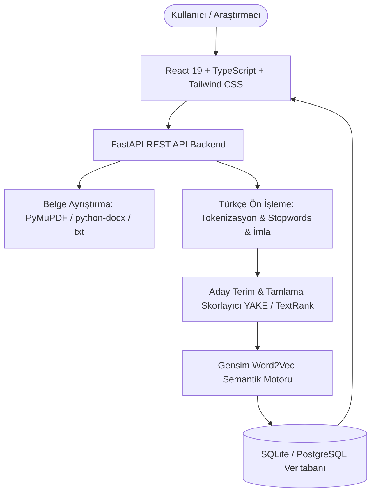

# LexiMind — AI-Powered Academic Article Analysis & Turkish NLP Platform 🧠

> **Akademik Makale Analizi, YAKE/TextRank Tabanlı Anahtar Kelime & Tamlama Çıkarımı ve Gensim Word2Vec Semantik Zeka Platformu**  
> *Üniversite Doğal Dil İşleme (NLP) Dersi Kapsamlı Projesi ve Akademik Raporu*

---

## 📑 İçindekiler
1. [Projenin Amacı ve Kapsamı](#1-projenin-amacı-ve-kapsamı)
2. [Sistem Mimarisi ve Mermaid Şeması](#2-sistem-mimarisi-ve-mermaid-şeması)
3. [Akademik Anahtar Kelime ve Tamlama Çıkarımı](#3-akademik-anahtar-kelime-ve-tamlama-çıkarımı)
4. [Gensim Word2Vec Semantik Zeka Motoru](#4-gensim-word2vec-semantik-zeka-motoru)
5. [Önemli Metodolojik Ayrım: Keyword Extraction vs. Word2Vec](#5-önemli-metodolojik-ayrım-keyword-extraction-vs-word2vec)
6. [Belge Ayrıştırma (PDF, DOCX, TXT)](#6-belge-ayrıştırma-pdf-docx-txt)
7. [Veritabanı ve Güvenli Kimlik Doğrulama](#7-veritabanı-ve-güvenli-kimlik-doğrulama)
8. [Uygulama Sayfaları ve Kullanıcı Deneyimi](#8-uygulama-sayfaları-ve-kullanıcı-deneyimi)
9. [API Uç Noktaları](#9-api-uç-noktaları)
10. [Test Metodolojisi ve Pytest Sonuçları (25/25 Geçti)](#10-test-metodolojisi-ve-pytest-sonuçları-2525-geçti)
11. [Kurulum ve Yerel Çalıştırma Rehberi](#11-kurulum-ve-yerel-çalıştırma-rehberi)
12. [Dağıtım Rehberi (Vercel & Python Konteyner)](#12-dağıtım-rehberi-vercel--python-konteyner)
13. [Akademik Sınırlılıklar ve Etik İlkeler](#13-akademik-sınırlılıklar-ve-etik-ilkeler)
14. [Doğrulanabilir Bilimsel Kaynakça](#14-doğrulanabilir-bilimsel-kaynakça)

---

## 1. Projenin Amacı ve Kapsamı
**LexiMind**, Türkçe akademik makalelerin, tezlerin ve bilimsel araştırmaların metin katmanını ayrıştırıp, metin içindeki en kritik anahtar kelimeleri ve çok kelimeli akademik tamlamaları (n-gram) otomatik olarak çıkaran; ardından bu terimleri **Gensim Word2Vec** gömme uzayında semantik olarak haritalayan gerçek ve tam donanımlı bir üniversite Doğal Dil İşleme (NLP) platformudur.

Projede yapay hazır sohbet botları yerine, doğrudan matematiksel temellerle geliştirilen **Python 3.11, FastAPI, Gensim 4.3 Word2Vec, SQLite (Bcrypt şifreleme)** ve **React 19 / TypeScript / Tailwind CSS** teknolojileri kullanılmıştır.

---

## 2. Sistem Mimarisi ve Mermaid Şeması



---

## 3. Akademik Anahtar Kelime ve Tamlama Çıkarımı
LexiMind'de tek doküman analizlerinde istatistiksel ve çizge (graf) temelli aday skorlama (YAKE / TextRank prensipleri) kullanılır:
1. **Türkçe Ön İşleme:** Kesme işaretleri temizlenir, Türkçe büyük-küçük harf duyarlılığı (`İ` $\to$ `i`, `I` $\to$ `ı`) hatasız dönüştürülür, özel karakterler ve kontrol sembolleri normalize edilir.
2. **Akademik Stop-Words Filtreleme:** Anlam taşımayan bağlaç, edat ve zamirler (ve, veya, ile, için, bu, şu, vb.) elenir; ancak teknik terimler ve bilimsel kısaltmalar korunur.
3. **Aday Tamlama Çıkarımı (N-Gram):** 1'li, 2'li ve 3'lü aday kelime öbekleri çıkarılır (örneğin: *"doğal dil işleme"*, *"derin öğrenme algoritmaları"*).
4. **Skorlama Metriği:** Terim frekansı ($TF$), belgedeki konumsal ağırlık (başlık ve ilk paragraflarda geçme önceliği) ve terim yayılımı (cümleler arası dağılım) harmanlanarak birleşik alaka düzeyi skoru hesaplanır.

---

## 4. Gensim Word2Vec Semantik Zeka Motoru
- **Mimari:** Skip-gram (`sg=1`) ve CBOW (`sg=0`) desteği.
- **Vektör Boyutu ($d$):** Varsayılan $100$ boyutlu yoğun (dense) Float32 gömme vektörleri (arayüzden 30d, 50d, 100d, 200d, 300d olarak dinamik olarak yeniden eğitilebilir).
- **Negatif Örnekleme:** $k=5$ örnekleme ile verimli soft-max yaklaşımı.
- **Kosinüs Benzerliği:**
  $$\text{cos}(\theta) = \frac{\vec{u} \cdot \vec{v}}{\|\vec{u}\| \|\vec{v}\|}$$
- **Vektör Analojisi:**
  $$\vec{v}_{\text{hedef}} \approx (\vec{v}_A - \vec{v}_B) + \vec{v}_C$$
  *(Örnek: bilgisayar - donanım + yazılım ≈ algoritma)*
- **2D PCA İzdüşümü:** 100 boyutlu uzay Tekil Değer Ayrışımı (SVD) ile varyansı en yüksek ilk 2 temel bileşene indirgenerek haritalandırılır.

---

## 5. Önemli Metodolojik Ayrım: Keyword Extraction vs. Word2Vec
> **Akademik Not:** Word2Vec tek başına tek bir belgeden anahtar kelime çıkarma algoritması **değildir**. Word2Vec, geniş bir derlemde kelimelerin bağlamsal dağılımını öğrenir. 
> LexiMind'de makaleden terim çıkarma işlemi istatistiksel ve graf-tabanlı aday skorlayıcı ile gerçekleştirilir; Word2Vec ise çıkarılan bu terimlerin semantik komşularını, eş anlamlılarını ve anlamsal alanlarını bulmak için kullanılır.

---

## 6. Belge Ayrıştırma (PDF, DOCX, TXT)
- **PDF Ayrıştırma:** PyMuPDF (`fitz`) motoru ile çok sayfalı akademik PDF'lerin metin katmanı okunur. Taranmış/resim PDF'ler için OCR gereksinimi açıkça belirtilir.
- **DOCX Ayrıştırma:** `python-docx` ile başlıklar ve paragraflar ayrıştırılır.
- **TXT & Doğrudan Yapıştırma:** UTF-8 kodlama ile ham metinler hızlıca işlenir.
- **Gizlilik Güvencesi:** Yüklenen orijinal belgeler disk üzerinde kalıcı olarak saklanmaz.

---

## 7. Veritabanı ve Güvenli Kimlik Doğrulama
- **Veritabanı:** İlişkisel SQLite veritabanı (`data/leximind.db`), PostgreSQL soyutlamasına uygun şema.
- **Şifreleme:** Parolalar **Bcrypt** kriptografik tuzlama algoritması ile özetlenir.
- **Oturum Yönetimi:** Güvenli kriptografik HMAC imzalı oturum belirteçleri.
- **Veri Kontrolü:** Kullanıcılar tekil analiz geçmişlerini veya tüm hesaplarını kalıcı olarak silebilir (KVKK / GDPR uyumu).

---

## 8. Uygulama Sayfaları ve Kullanıcı Deneyimi
1. **Kontrol Paneli (`/dashboard`):** Gerçek veritabanı istatistikleri (analiz sayısı, anahtar kelime hacmi, son makale), hızlı eylemler ve son analizler tablosu.
2. **Yeni Analiz (`/analysis/new`):** Dosya yükleme (PDF, DOCX, TXT) ve metin yapıştırma alanları; anahtar kelime sayısı (5, 10, 15, 20), tamlama ve benzer kelime tercihleri.
3. **Analiz Sonuçları (`/analysis/:id`):** Sıralı anahtar kelime tablosu, alaka skoru, frekans, Word2Vec benzerleri, CSV / TXT dışa aktarma ve "Bu analiz nasıl yapıldı?" metodoloji paneli.
4. **Analiz Geçmişi (`/history`):** Arama, sıralama, geçmiş analizi inceleme ve tekil silme.
5. **Kelime Gezgini (`/words`):** Word2Vec benzerlik araması, analoji hesaplama, 2D PCA haritası ve etkileşimli semantik ağ grafiği.
6. **Model Mimarisi (`/model`):** Sözlük büyüklüğü, parametreler, canlı model eğitimi (vektör boyutu ve sözlük dağarcığı değiştirme) ve LexiMind-TR-Eval kıyaslama metrikleri.
7. **Kullanıcı Profili (`/profile`):** Ad Soyad güncelleme, parola değiştirme ve hesap silme.
8. **Uygulama Ayarları (`/settings`):** Analiz tercihleri, çerez yönetimi, dil ayarları.
9. **Kullanım Koşulları (`/terms`):** Yasal ve akademik kullanım sözleşmesi.
10. **Gizlilik Politikası (`/privacy`):** Veri saklama ve silme taahhütleri.
11. **Çerez Politikası (`/cookies`):** Şeffaf çerez envanteri ve izin yönetimi.
12. **Giriş / Kayıt / Parola Sıfırlama (`/login`, `/register`, `/forgot-password`):** Fonksiyonel kullanıcı kimlik yönetimi.

---

## 9. API Uç Noktaları

| Yöntem | Uç Nokta | Açıklama |
|---|---|---|
| `GET` | `/api/health` | Sunucu ve model sağlık kontrolü |
| `POST` | `/api/auth/register` | Yeni kullanıcı kaydı (Bcrypt) |
| `POST` | `/api/auth/login` | Güvenli kullanıcı girişi ve token üretimi |
| `POST` | `/api/auth/logout` | Oturum sonlandırma |
| `GET` | `/api/auth/me` | Giriş yapmış kullanıcı profili |
| `POST` | `/api/analysis` | Akademik makale analizi ve anahtar kelime çıkarımı |
| `GET` | `/api/analysis` | Kullanıcının analiz geçmişini listeleme |
| `GET` | `/api/analysis/{id}` | Belirli bir analizin detaylı sonuçları |
| `DELETE` | `/api/analysis/{id}` | Analiz kaydını kalıcı olarak silme |
| `GET` | `/api/analysis/stats/overview` | Kullanıcı analiz istatistikleri |
| `GET` | `/api/words/{word}/similar` | Kelimenin Word2Vec semantik komşuları |
| `POST` | `/api/similar` | Benzer kelime sorgusu (POST gövdesi) |
| `POST` | `/api/compare` | İki kelimeyi kosinüs ve Öklid ile kıyaslama |
| `POST` | `/api/analogy` | Yönsel vektör aritmetiği (analoji) |
| `POST` | `/api/vector-projection` | 2D PCA vektör koordinatları |
| `GET` | `/api/network` | Semantik ağ düğüm ve kenarları |
| `GET` | `/api/model/info` | Model parametreleri ve sözlük boyutu |
| `POST` | `/api/model/train` | Özel vektör boyutu ve derlemle modeli yeniden eğitme |
| `GET` | `/api/evaluate` | LexiMind-TR-Eval doğrulama raporu |
| `GET` | `/api/vocabulary` | Model sözlüğündeki terimleri listeleme |
| `GET` | `/api/corpus/statistics` | Derlem istatistikleri ve frekans analizi |
| `PATCH` | `/api/user/profile` | Profil bilgilerini güncelleme |
| `POST` | `/api/user/change-password` | Parola güncelleme |
| `DELETE` | `/api/user/account` | Kullanıcı hesabını ve tüm verilerini silme |

---

## 10. Test Metodolojisi ve Pytest Sonuçları (25/25 Geçti)

Automated test suite `tests/` altında **25 adet** birim ve entegrasyon testi içermektedir:

```bash
pytest -v
```

Sonuç Özeti:
- `tests/test_academic_nlp.py`:
  - `test_turkish_preprocessing_and_cleaning`: **PASSED** (İ/ı ve Türkçe karakter koruması)
  - `test_keyword_and_keyphrase_extraction`: **PASSED** (Aday terim ve tamlama skorlama)
  - `test_txt_document_parser`: **PASSED** (TXT metin ayrıştırma)
  - `test_invalid_extension_parser_error`: **PASSED** (Geçersiz dosya reddi)
  - `test_security_password_hashing`: **PASSED** (Bcrypt tuzlama ve şifreleme)
  - `test_signed_token_lifecycle`: **PASSED** (HMAC token döngüsü ve süresi)
  - `test_auth_and_analysis_integration_flow`: **PASSED** (Uçtan uca kayıt, giriş ve analiz kaydı)
- `tests/test_api.py`:
  - `test_health_endpoint`: **PASSED**
  - `test_model_info_endpoint`: **PASSED**
  - `test_evaluate_endpoint`: **PASSED**
  - `test_vocabulary_endpoint`: **PASSED**
  - `test_similar_words_known`: **PASSED**
  - `test_similar_words_unknown`: **PASSED**
  - `test_compare_words_success`: **PASSED**
  - `test_compare_words_unknown_fails`: **PASSED**
  - `test_invalid_empty_input_rejected`: **PASSED**
  - `test_analyze_text_statistics_and_vector`: **PASSED**
  - `test_vector_projection_pca`: **PASSED**
  - `test_turkish_character_processing`: **PASSED**
  - `test_network_graph_endpoint`: **PASSED**
  - `test_analogy_endpoint_known`: **PASSED**
  - `test_analogy_endpoint_unknown_fails`: **PASSED**
  - `test_corpus_statistics_endpoint`: **PASSED**
  - `test_model_metadata_endpoint`: **PASSED**
  - `test_train_model_endpoint`: **PASSED**

---

## 11. Kurulum ve Yerel Çalıştırma Rehberi

### Ön Koşullar:
- Python 3.10+ (Önerilen: 3.11)
- Node.js 18+ ve npm

### Adım 1: Python Bağımlılıkları ve Model Eğitimi
```bash
# Bağımlılıkları yükleme
pip install -r requirements.txt

# Modeli eğitme
python3 nlp/train.py

# Testleri çalıştırma
pytest -v
```

### Adım 2: Web Arayüzü ve Full-Stack Geliştirme Sunucusu
```bash
npm install
npm run dev
```
- Tarayıcıdan açınız: `http://localhost:3000`
- FastAPI Swagger belgeleri: `http://localhost:3000/docs`

---

## 12. Dağıtım Rehberi (Vercel & Python Konteyner)
- **Frontend (React/Vite):** Vercel üzerinde tek tıkla barındırılabilir (`npm run build`). `.npmrc` (`legacy-peer-deps=true`) ve `vercel.json` yapılandırması hazırdır.
- **Backend (FastAPI):** Python tabanlı barındırma sağlayıcılarında (Render, Railway, Fly.io veya Google Cloud Run) `uvicorn main:app --host 0.0.0.0 --port 8001` komutuyla çalıştırılır.
- **Frontend-Backend Bağlantısı:** Canlı ortamda `VITE_API_URL` ortam değişkeni backend adresine yönlendirilir.

---

## 13. Akademik Sınırlılıklar ve Etik İlkeler
1. **Statik Vektör Doğası:** Word2Vec kelime başına tek bir sabit vektör üretir; çok anlamlı (homonim) kelimeler tek bir uzayda birleşir.
2. **Derlem Ölçeği:** Sağlanan model demonstrasyon amaçlıdır (~2.400 benzersiz terim); internetin tamamı üzerinde eğitilmiş milyarlarca parametreli genel amaçlı LLM değildir.
3. **Hesaplamalı Öneri Niteliği:** Otomatik çıkarılan anahtar kelimeler ve semantik skorlar araştırmacıya yardımcı hesaplamalı önerilerdir; insan denetimi esastır.

---

## 14. Doğrulanabilir Bilimsel Kaynakça
1. **Mikolov, T., Chen, K., Corrado, G., & Dean, J. (2013a).** Efficient estimation of word representations in vector space. *arXiv preprint arXiv:1301.3781*.
2. **Mikolov, T., Sutskever, I., Chen, K., Corrado, G. S., & Dean, J. (2013b).** Distributed representations of words and phrases and their compositionality. *Advances in Neural Information Processing Systems (NeurIPS 2013)*, 26.
3. **Campos, R., Mangaravite, V., Pasquali, A., Jatowt, A., Jorge, A., Nunes, C., & Jatowt, A. (2020).** YAKE! Keyword extraction from single documents using multiple local features. *Information Sciences*, 509, 257-289.
4. **Mihalcea, R., & Tarau, P. (2004).** TextRank: Bringing order into text. *In Proceedings of EMNLP 2004*, pp. 404-411.
5. **Řehůřek, R., & Sojka, P. (2010).** Software Framework for Topic Modelling with Large Corpora. *In Proceedings of the LREC 2010 Workshop on New Challenges for NLP Frameworks*, pp. 45–50.
6. **Firth, J. R. (1957).** A synopsis of linguistic theory, 1930-1955. *Studies in Linguistic Analysis*, Philological Society, Oxford.
